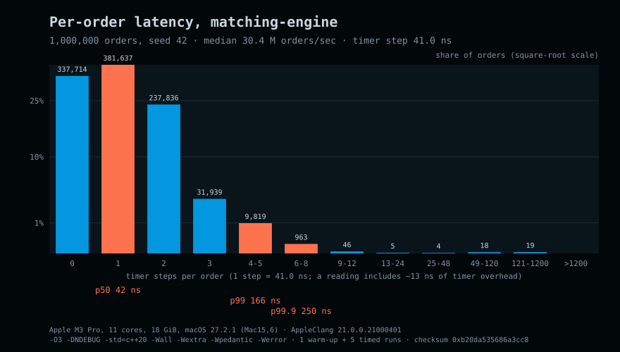

# matching-engine

A single-symbol limit order book and matching engine in C++20, with a proof that it
matches correctly and speed numbers anyone can reproduce.

## At a glance

- **What it is.** The part of a stock exchange that pairs buyers with sellers: it keeps
  the waiting orders for one stock and decides who trades with whom, at what price.
- **Why.** Order books are easy to write and easy to get subtly wrong, and published
  speed numbers rarely say how they were measured. This one proves its matching is
  correct and reports speed in a way anyone can rerun.
- **Who it's for.** People learning how exchanges really match orders, and anyone who
  wants an honest, reproducible benchmark of an order book.
- **How it works.** Orders (limit, market, IOC, FOK, cancel, modify) go into a fast book
  that matches by price, then arrival time, and reports every trade as an event. A second,
  deliberately simple book runs the same orders, and a test demands identical events.
- **Proof it is right.** A slow, obviously correct reference matcher runs the same
  seeded random orders as the fast book, and the two must agree on every event and on
  the final book. Measured: `difftest: seed 1: 2,000,000 orders, 431,042 trades, 2,258,787 events, 451 resting at the end: engine and reference agree on every event and on the final book`
- **How fast.** **30.44 M orders/sec** (median of 5 timed runs, 1,000,000 seeded orders,
  one core), per-order latency p50 42 ns, p99 166 ns, p99.9 250 ns, on an Apple M3 Pro.
  Every number below comes from `./reproduce`, whose raw output is in [`results/`](results/).
- **Try it.** `./bench` for the benchmark, `build/release/me ladder scenarios/walkthrough.txt`
  to watch every match as a price ladder, [EXPLAIN.md](EXPLAIN.md) if order books are new to you.



## Results

Machine and build, as `./bench` printed them (`results/bench.txt`):

| | |
|---|---|
| machine | Apple M3 Pro, 11 cores, 18 GiB, macOS 27.2.1 (Mac15,6) |
| compiler | AppleClang 21.0.0.21000401 |
| flags | `-O3 -DNDEBUG -std=c++20 -Wall -Wextra -Wpedantic -Werror` (Release build, CMake + Ninja) |
| flow | seed 42, 1,000,000 orders: 47% limit, 6% market, 6% IOC, 4% FOK, 28.8% cancel, 8% modify, 0.2% invalid |
| runs | 1 warm-up + 5 timed, a fresh book each run |
| checksum | `0xb20da535686a3cc8` (1,130,769 events, 218,407 trades) |
| timer | `std::chrono::steady_clock`, one step = 41.0 ns, 13.3 ns per call |

| metric | value |
|---|---|
| orders/sec (median of 5) | 30.44 M |
| orders/sec (min .. max) | 30.31 M .. 34.05 M |
| mean ns/order (from throughput) | 32.9 ns |
| p50 | 42 ns |
| p90 | 84 ns |
| p99 | 166 ns |
| p99.9 | 250 ns |
| max | 13458 ns |

Replay of market-maker-sim's three strategies' fills (`results/replay.txt`):
`replay: 3 file(s), 4,187 fills, 8,374 orders, 4,187 trades, inventory matches`, at
6.40 M orders/sec (median of 50 replays).

**How to read these numbers.**

- *Orders/sec* counts every command (new orders, cancels, modifies, invalid ones) on one
  thread, with the events going to a sink that hashes them. Nothing is printed or
  allocated per order once the book is warm.
- *Latency* comes from a separate pass that timestamps each order. On this Mac the clock
  moves in steps of 41.0 ns (a 24 MHz counter), longer than the average order takes
  (32.9 ns), so each reading is a whole number of steps and includes about 13.3 ns of the
  timer's own cost. The p50 of 42 ns means "one step"; the histogram is drawn in steps for that
  reason. The tail (p99.9, max) is real: it is where cache misses, new price levels and
  the occasional page fault or interrupt show up.
- *Reproducible.* The same seed and flags always give the same orders, the same
  1,130,769 events and the same checksum. The second run `./reproduce` saves in
  `results/rerun/` gave the same checksum, 35.38 M orders/sec, p99 125 ns and p99.9 209 ns:
  so between two runs the median moved 16% (30.44 M to 35.38 M) and the tail by a timer
  step or two; inside one run the five timed passes spanned 12% (30.31 M .. 34.05 M).
  Treat the speed as "low tens of millions of orders a second on this laptop", not as a
  precise figure.
- *The replay is small and shallow* (4,187 fills, one resting order at a time), so its
  orders/sec is dominated by touching a fresh book's memory, not by matching. It shows
  the engine reproduces the simulator's fills exactly; it is not a stress test.

## Design note

The fast book (`include/me/book.hpp`) uses four data structures, each chosen for one
operation.

1. **Price levels indexed directly by price.** Each side has an array with one level per
   tick in the price band ($0.01 to $1,310.71, so 131,071 levels and about 3 MB per side).
   Finding the level for a price is one array access, because the price *is* the index.
   A `std::map<price, level>` would cost a tree walk and a pointer chase per new level.
   The price band is the trade-off: prices outside it are rejected (DECISIONS.md D3).
2. **A bitmap of non-empty levels.** One bit per level, 64 levels per word. When the
   best level empties, the next best is found with a count-leading or count-trailing
   zeros instruction over a few words, so that the best price is always known without
   scanning empty levels one by one.
3. **An intrusive FIFO per level.** Each resting order is a node with `prev` and `next`
   indices inside one pool vector, and each level keeps head, tail and total quantity.
   Matching walks from the head, which is time priority. Nodes are recycled through a
   free list, so the steady state allocates nothing.
4. **A hash map from order id to node: O(1) cancel.** An open-addressing hash map with
   linear probing maps each id to its node, so cancel and modify find the order in one
   lookup and unlink it in constant time, because the node knows its neighbours.
   Entries are never erased (a finished order is marked gone), so that a reused id is
   still caught as a duplicate and probing needs no tombstones.

Events go to a sink chosen at compile time (`Book<Sink>`), so the benchmark's hashing
sink and the tests' recording sink cost no virtual call.

**The reference matcher** (`include/me/reference.hpp`) has none of this. It keeps every
resting order in one vector and, for each fill, scans all of it for the best price and
then the earliest arrival. It is slow on purpose, because a reader can check it against
the rules in a minute.

## How it is checked

- **Differential test.** `tests/test_differential.cpp` runs 4 seeds x 500,000 orders
  through both matchers and compares every event, command by command, and the final
  book. It also proves the comparison can fail: a deliberately wrong engine (one trade's
  quantity changed, or one resting order missing) must be caught at the right command.
  The seeded flow is generated with splitmix64 and integer arithmetic, not
  `std::*_distribution`, because those may differ between standard libraries.
- **Unit tests.** 25 cases for matching (partial fills, sweeps on both sides, cancels of
  resting, filled and expired orders, empty book, rejects) and 17 for modify, IOC and
  FOK, each checking the exact event list.
- **CLI tests.** The `me` binary is run for real: an exact golden ladder, the
  walkthrough's key moments, and every error path (one `error:` line, exit 2).
- **Benchmark and docs tests.** `tests/test_bench.sh` ties every printed number to
  `bench.json` and the histogram; `tests/test_docs.sh` checks that every number in this
  README matches `results/`.
- **`./validate`** runs all of it on a Release build with warnings as errors, then again
  under AddressSanitizer and UndefinedBehaviorSanitizer. The test runner is
  `tests/testlib.hpp`, written for this project; nothing is installed.

## How to run it

Needs CMake, Ninja, a C++20 compiler and Python 3 (standard library only).

```
./validate                                    # build, every test, sanitizers
./bench                                       # the benchmark; writes results/
./reproduce                                   # every number in this README
build/release/me ladder scenarios/walkthrough.txt
build/release/me difftest --orders 2000000 --seed 7
build/release/me replay ~/Projects/market-maker-sim/results/fills_*.csv
```

Scenario files take one command per line: `limit|ioc|fok <buy|sell> <id> <price> <qty>`,
`market <buy|sell> <id> <qty>`, `cancel <id>`, `modify <id> <price> <qty>`.

## Limits

- One symbol, one thread, in memory. No networking, FIX, persistence or GUI (on purpose).
- Prices must sit in the $0.01 to $1,310.71 band; a wider market needs a re-centred or
  sparse level array.
- No self-trade prevention, no stop, hidden or iceberg orders. Modify always loses queue
  priority, even for a quantity decrease (DECISIONS.md D4).
- The numbers are from one laptop. The synthetic flow keeps the book small (a few
  hundred resting orders), which is kind to caches; a deep book would be slower.
- Latency below one timer step (41.0 ns here) cannot be resolved on this machine.
